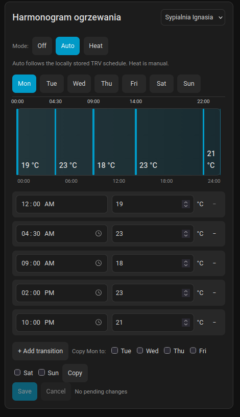

# Scheduler Card TRVZB

A standalone Home Assistant dashboard card for editing the weekly heating schedule stored inside a [SONOFF TRVZB](https://www.zigbee2mqtt.io/devices/TRVZB.html) radiator valve. It registers as `trvzb-internal-scheduler-card`, so it can coexist with the upstream `scheduler-card`.

The valve—not Home Assistant—executes the schedule. After an explicit save, put the valve in `auto` to have it follow its locally stored schedule, including while Home Assistant, Zigbee2MQTT, or the coordinator are offline. Those services must be online to view or edit the schedule.

## Preview



The screenshot shows the graphical editor for a TRVZB's internal weekly heating schedule.

## Requirements

- Home Assistant OS or another supported Home Assistant installation, with a dashboard that can load custom JavaScript resources.
- HACS/Marketplace for the recommended installation method. The HACS 2.x release requires Home Assistant 2024.4.1 or newer; HACS/Marketplace navigation labels vary by Home Assistant version.
- A SONOFF TRVZB paired with Zigbee2MQTT, Home Assistant MQTT discovery enabled, and the Home Assistant MQTT integration working.
- All seven Zigbee2MQTT daily schedule exposes must appear in Home Assistant as writable `text.*` entities: `weekly_schedule_monday` through `weekly_schedule_sunday`.

The official TRVZB documentation currently lists the seven daily text exposes, but does not state a minimum Zigbee2MQTT version for them. Therefore this project does **not** claim a version floor: use a current Zigbee2MQTT version and confirm that all seven text entities exist before installing the card. The card uses Home Assistant's `text.set_value` action for writes; it never exposes MQTT credentials or opens an MQTT connection in the browser. [`text.set_value` is the documented Home Assistant action for writable text entities.](https://www.home-assistant.io/integrations/text/)

This card does **not** require eWeLink, a SONOFF Zigbee Bridge Pro, nielsfaber's Scheduler Component, Home Assistant schedule helpers, or time-triggered Home Assistant automations.

## Install with HACS (recommended)

1. Install and configure HACS (or use the Marketplace interface supplied by your Home Assistant release).
2. Open HACS, open the menu, choose **Custom repositories**, and add:

   ```text
   https://github.com/IgooGG/scheduler-card-TRVZB
   ```

3. Select the **Dashboard** repository category. HACS calls this category a "plugin" internally.
4. Find **Scheduler Card TRVZB**, open it, and choose **Download**. No Node.js, npm, or local build is needed on Home Assistant.
5. HACS normally registers the JavaScript module automatically for storage-managed dashboards. Verify it under **Settings → Dashboards → Resources**. If it is not registered, or if the dashboard is YAML-managed, add this resource manually with type **JavaScript module**:

   ```text
   /hacsfiles/scheduler-card-TRVZB/scheduler-card-TRVZB.js
   ```

6. Reload the browser (a hard refresh is safest) and add one of the configurations below.

To update, use **Redownload** in HACS and refresh the browser. Do not replace the HACS resource with `/local/...`; HACS manages its own versioned resource URL. To uninstall, remove the card from dashboards and remove any manually added HACS resource, then select **Remove** for the repository in HACS and refresh the browser. The card has no separately stored schedule data to remove: schedules remain on the valves.

## Manual installation

1. Download the compiled `scheduler-card-TRVZB.js` asset from the desired GitHub release (or build it from this repository).
2. Copy it to Home Assistant's `/config/www/scheduler-card-TRVZB.js`.
3. In **Settings → Dashboards → Resources**, add or replace this resource with type **JavaScript module**:

   ```text
   /local/scheduler-card-TRVZB.js
   ```

4. Reload the browser and add the YAML configuration below.

For manual updates, replace the file in `/config/www/` and hard-refresh the browser. During development, either clear the browser cache or change the resource URL to a new query string such as `/local/scheduler-card-TRVZB.js?v=20261018`; do not add duplicate resource entries. `/local/` is for `/config/www/`; `/hacsfiles/` is only for a HACS-managed installation.

## Lovelace configuration

### One thermostat

```yaml
type: custom:trvzb-internal-scheduler-card
entity: climate.sypialniaignasiagrzejnik
title: Heating schedule
```

### Multiple thermostats

Use `thermostats` to show an ordered selector. These are examples, not card defaults.

```yaml
type: custom:trvzb-internal-scheduler-card
title: Harmonogram ogrzewania
show_warnings: false
thermostats:
  - entity: climate.sypialniaignasiagrzejnik
    name: Sypialnia Ignasia
  - entity: climate.sypialniatatygrzejnik
    name: Sypialnia Taty
  - entity: climate.kuchniagrzejnik
    name: Salon / Kuchnia
confirmation_timeout: 30
stale_after_hours: 24
```

### Entity discovery and explicit mapping

The card first looks for `text.<climate-slug>_weekly_schedule_<day>`. If the IDs differ, supply every day explicitly:

```yaml
type: custom:trvzb-internal-scheduler-card
entity: climate.sypialniaignasiagrzejnik
schedule_entities:
  monday: text.ignasia_weekly_schedule_monday
  tuesday: text.ignasia_weekly_schedule_tuesday
  wednesday: text.ignasia_weekly_schedule_wednesday
  thursday: text.ignasia_weekly_schedule_thursday
  friday: text.ignasia_weekly_schedule_friday
  saturday: text.ignasia_weekly_schedule_saturday
  sunday: text.ignasia_weekly_schedule_sunday
```

| Option                 | Meaning                                                                                                                                                                                                                           |
| ---------------------- | --------------------------------------------------------------------------------------------------------------------------------------------------------------------------------------------------------------------------------- |
| `type`                 | Required: `custom:trvzb-internal-scheduler-card`.                                                                                                                                                                                 |
| `entity`               | One TRVZB climate entity; use this or `thermostats`.                                                                                                                                                                              |
| `thermostats`          | Ordered climate-entity list, or objects with `entity`, optional `name`, and optional `schedule_entities`.                                                                                                                         |
| `title`                | Optional card title.                                                                                                                                                                                                              |
| `schedule_entities`    | Explicit seven-day mapping when automatic discovery cannot find the text entities.                                                                                                                                                |
| `confirmation_timeout` | Seconds to wait for an observed Home Assistant text-state update after Save (default `30`, minimum effective value `5`).                                                                                                          |
| `stale_after_hours`    | Age after which the oldest cached schedule state is marked stale (default `24`).                                                                                                                                                  |
| `show_warnings`        | Defaults to `true`. Set `false` to hide only the cached-state and exact-duplicate-normalization informational notices. Stale-cache, validation, unavailable-device, write-failure, and unconfirmed-write warnings remain visible. |
| `debug`                | Optional troubleshooting panel and non-sensitive console diagnostics. Set `true` temporarily; it does not expose credentials or schedule values.                                                                                  |

## What the card does

- Reads all seven cached Home Assistant `text.weekly_schedule_*` states and keeps the original data until you explicitly save.
- Provides one spacious, responsive day editor at a time: weekday tabs, a timeline, five-minute marker dragging, exact time inputs, Celsius temperature inputs, adding/removing transitions, and copying the selected day to other days.
- Enforces the documented TRVZB rules: at most six transitions per day, first transition at `00:00`, strictly increasing unique times, 4–35 °C, and 0.5 °C temperature increments. Values are always shown and serialized in Celsius, even if Home Assistant displays the climate entity in Fahrenheit.
- Normalizes only consecutive duplicate cached entries where both time and temperature are identical. Conflicting same-time temperatures remain a validation error. Normalization is UI-only and is never sent to a valve until an explicit Save changes that day.
- Provides `off`, `auto`, and `heat` mode controls. Only `auto` follows the locally stored TRV schedule; mode changes do not edit a schedule.
- Shows pending changes and offers **Cancel**. Switching thermostats and leaving the page prompts before discarding unsaved edits where the browser permits it.
- Saves only changed days through `text.set_value`, then waits for the expected Home Assistant entity state. A service-call acceptance is not presented as a confirmed save. Partial failures retain unconfirmed edits for retry.

The TRVZB documentation says the daily weekly-schedule properties cannot be read through Zigbee2MQTT's `/get` mechanism. The card therefore works from Home Assistant/Zigbee2MQTT cached values, labels stale cache data, and never pretends to obtain a fresh physical-device read. Check the entity states or Zigbee2MQTT after a write when you need confirmation of the device's physical state.

## Verify a real write safely

1. In **Developer Tools → States**, note one `text.*_weekly_schedule_<day>` value.
2. Make a deliberate change in the card and press **Save**.
3. Wait for the card's confirmation, then verify that same text entity has the displayed `HH:mm/temperature` string.
4. Set the climate entity to `auto` and verify the TRV's auto/timer indicator.

Do this only on a schedule you intend to change. The card cannot edit or read a valve while Home Assistant, Zigbee2MQTT, or the coordinator is unavailable.

## Troubleshooting

- **Schedule entities were not found:** enable Zigbee2MQTT Home Assistant discovery, confirm all seven daily text entities exist, or configure `schedule_entities` explicitly.
- **Unavailable or malformed schedule:** the card does not fabricate a schedule. Restore Home Assistant/Zigbee2MQTT connectivity or correct the source state first.
- **Stale cache:** the card warns but does not claim the device was freshly read. Review entity values before saving.
- **Save timed out or was incomplete:** Home Assistant did not observe every requested text-state update. Inspect the entity and Zigbee2MQTT log before retrying; confirmed days remain confirmed and other edits remain pending.
- **Schedule does not run:** use `auto`, not manual `heat`.
- **Card not found:** verify exactly one module resource points to the matching installation path, then hard-refresh the browser.

## Packaging, CI, and releases

The HACS distribution is the tracked production bundle `dist/scheduler-card-TRVZB.js`. Its name matches the repository name as required for a Dashboard/plugin repository. The Rollup entry point is `src/trvzb-internal-scheduler-card.ts`; it registers only `trvzb-internal-scheduler-card` and adds matching card-picker metadata, so it does not register upstream's `scheduler-card` element.

HACS accepts Dashboard/plugin repositories with a matching JavaScript file under `dist/`. Before a first release, HACS can use the default branch's tracked bundle. Tagged releases are optional for custom-repository use, but recommended: `release.yml` validates, builds, and attaches the same `scheduler-card-TRVZB.js` file to the generated GitHub release. HACS can then offer releases as installable versions. Users never need Node.js or npm.

`ci.yml` runs reproducible dependency installation, tests, TypeScript checking, ESLint, Prettier checking, and Rollup through `npm run build`. `validate.yaml` runs HACS's plugin validation. The manual `build.yaml` workflow provides the same reproducible verification and a correctly named artifact. The release workflow accepts `v*` tags but fails unless the tag is exactly `v` plus the version in `package.json`.

### Maintainer release checklist

1. Run `npm ci`, `npm test`, and `npm run build` locally.
2. Commit the updated `dist/scheduler-card-TRVZB.js` with the source and documentation changes.
3. Update `package.json` to the intended release version, commit it, then create and push the matching `vX.Y.Z` tag. The release workflow creates the GitHub release and uploads the compiled bundle.
4. Confirm the workflow succeeds before telling users to install the release.

## HACS catalogue readiness

Adding this public URL as a **custom Dashboard repository** does not require the project to be in the default HACS catalogue. Catalogue inclusion is a separate review process and additionally requires a public GitHub repository, a full GitHub release, a passing HACS Action with no ignored checks, an OSI-recognized license, README images, repository description, GitHub Issues enabled, and repository topics.

The README image above satisfies the image requirement once committed. GitHub repository settings cannot be changed from this checkout: before applying for default-catalogue inclusion, enable **Issues**, add a repository description, and add topics such as `home-assistant`, `hacs`, `lovelace`, `zigbee2mqtt`, `sonoff`, and `trvzb`. Verify those settings and the first published release on GitHub before submitting to `hacs/default`.

## License and attribution

This fork is GPL-3.0-or-later; retain [LICENSE](LICENSE). It began as a fork of [nielsfaber/scheduler-card](https://github.com/nielsfaber/scheduler-card), whose GPL source and attribution remain here. The schedule format and behavior were reviewed against [abaddon/ha_sonoff_TRVZB_scheduler_card](https://github.com/abaddon/ha_sonoff_TRVZB_scheduler_card) (MIT); no source files from that project were copied.

## Verification status

The automated tests use mocked Home Assistant state and service calls; no physical TRV, MQTT broker, or Home Assistant installation is contacted during tests. They cover parsing/serialization, constraints, duplicate handling, changed-day preservation, discovery, unavailable/malformed/stale cached state, save acknowledgement failure recovery, and rendering of the duplicate-normalized editor. HACS and Home Assistant installation have not been exercised end-to-end in this checkout; follow the installation and real-write verification steps above after release.
